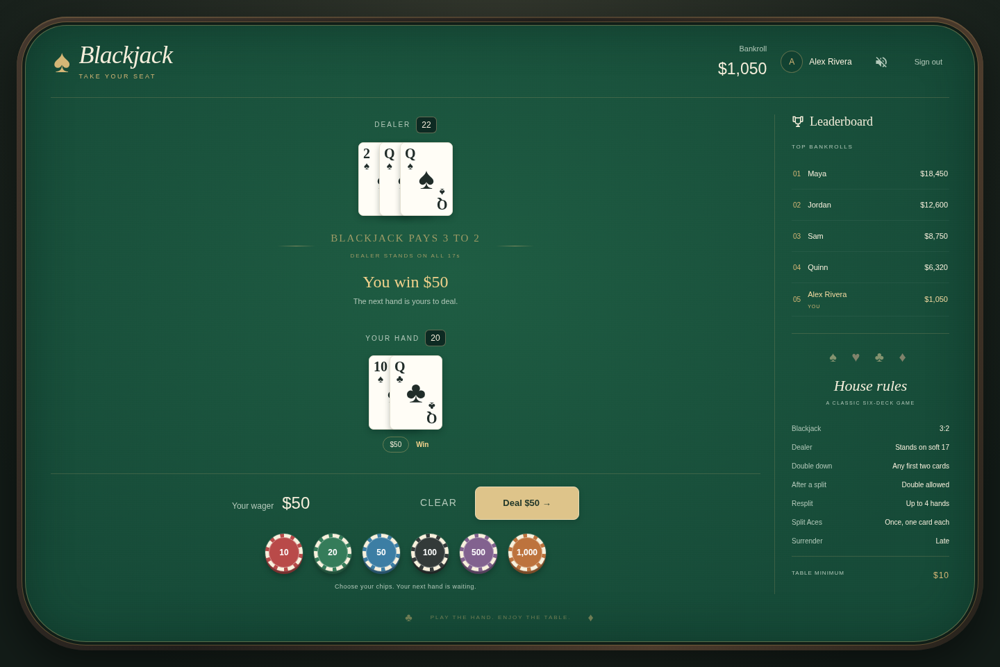
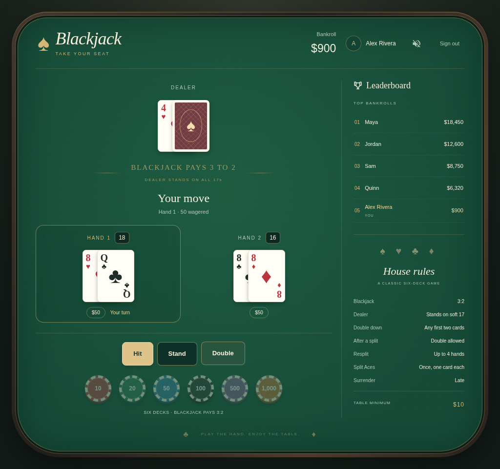
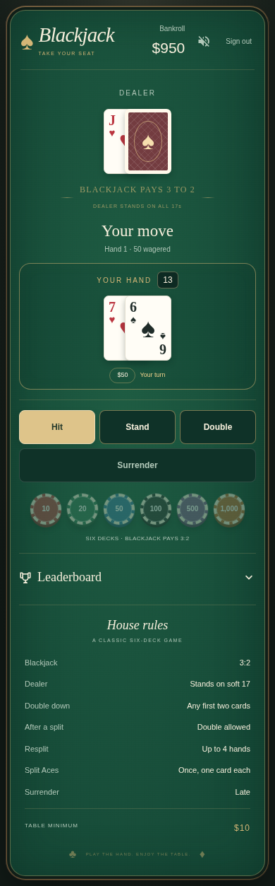
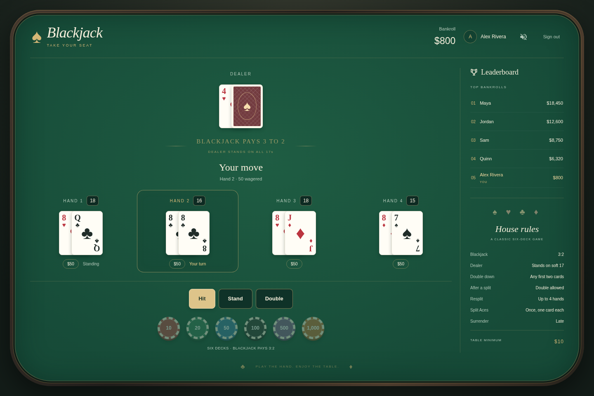

# BLACK JACK

Blackjack game built with Nuxt, Vue, Vuetify, and TypeScript. Vue components use the Composition API with `<script setup lang="ts">`. The browser game and the command-line simulator use the same rules engine in `game/blackjack.ts`.

Visit official game at: [Black Jack Game](https://jaimegonzalezjr.com/games/blackjack/).

## Built With
* Nuxt 4 and Vue 3
* Vuetify 3
* Strapi headless CMS

## Rules

The game uses this disclosed rules profile:

* Six 52-card decks with a 75% cut point
* Dealer peek for blackjack and stand on all 17s, including soft 17
* Natural blackjack pays 3:2; a normal win pays 1:1
* Insurance pays 2:1 and is offered only against a dealer Ace
* Double on any first two cards, including after a split
* Resplit equal ranks to four hands
* Split Aces once; each split Ace receives one card
* Late surrender after the dealer checks for blackjack
* Even-dollar wagers with a $10 minimum, so 3:2 and half-wager settlements remain whole-dollar account values

The game does not claim a fixed RTP. Return depends on the rules, player decisions, and the definition of wagered money. The simulator reports both the loss per original round wager and the return on all action, including split and double wagers.

This repository implements game rules and verifies their math. It is not a Nevada gaming license, laboratory certification, or approval to accept real-money wagers.

## Table layout

Betting chips, hand actions, results, and the leaderboard stay on the blackjack table. Selecting chips previews a wager. The bank changes when you press Deal. A settled hand stays visible while you choose your next wager.

Desktop layouts show the leaderboard beside the hands. On smaller screens, the leaderboard expands inline below the game. Split hands wrap into two columns on phones and tablets.

## Screenshots

These screenshots come from the browser tests with seeded hands and synthetic player accounts.






To refresh the screenshots, run `UPDATE_REPO_SCREENSHOTS=1 npm run test:e2e`.

## Build Setup

```bash
# Install dependencies
npm install

# Start the development server at localhost:3000
npm run dev

# Build and preview the production server
npm run build
npm run start

# Generate the static site
npm run generate

# Run unit and browser tests
npm run test:unit
npm run test:e2e

# Check TypeScript and the Composition API source policy
npm run typecheck
npm run check:source

# Simulate one million basic-strategy rounds with a repeatable seed
npm run simulate -- --rounds=1000000 --seed=20261017
```

The simulator declines insurance because insurance has negative expected value without information about the remaining shoe. Change `--seed` to sample another shuffle sequence.

`npm test` runs the source policy check, type checking, unit tests, and browser tests. Application source, configuration, scripts, and tests use TypeScript. The source policy rejects JavaScript files and Vue scripts without both `setup` and `lang="ts"`. Generated bundles and the externally hosted shared-account library remain JavaScript browser assets.

## Google account login and Web Station deployment

The browser uses native Strapi REST with a shared strapi_jwt local-storage bearer token. Google returns to this app's own `/games/blackjack/auth/google` callback. The reusable account client and form are served from `https://api.jaimegonzalezjr.com/auth/client.v1.js` and maintained in the Strapi repository. Native game collections enforce account ownership on the server. Existing anonymous names require administrator migration. API_BASE_URL defaults to https://api.jaimegonzalezjr.com.


The app uses Nuxt 4, Vue 3, Vite, and Vuetify 3 on Node 22.19 or newer. Playwright builds the production app before running its browser tests.

Account controls mount inside this app's own layout. Strapi Content Manager → OAuth Applications configures callback/return URLs, Google/password options, registration, and shared/separate sessions. Current configuration is Google with shared login. No provider secrets belong in frontend environment files.

## Local configuration and publishing

Normal builds use `/` as their base path. Set `APP_BASE_PATH` in the build environment to host under a subdirectory; unset or empty leaves the default. Set `API_BASE_URL` for the compatible shared-account backend. Environment values are embedded during the build. Private `.env` overrides are ignored by Git; only `.env.example` is tracked.

Build the application using its normal npm build/generate command, then publish the completed static output with your own hosting tools. Personal paths and settings belong in the ignored repo-local `.env`, outside version control. Configure the backend OAuth application registry with this deployment's own callback and return URLs. Browser route guards do not replace backend ownership checks.

### Output directory override

The ignored repo-local `.env` can set `BUILD_OUTPUT` to a directory. Unset or empty keeps the framework's normal output folder. The framework cleans that output during generation/build, so obsolete files do not accumulate.

A local installation can point `BUILD_OUTPUT` directly at its hosted app directory and use the normal npm build/generate command without a deployment script. A failed build can leave that directory incomplete until the next successful build. Keep persistent data outside the build output. Personal paths and environment overrides remain untracked.
